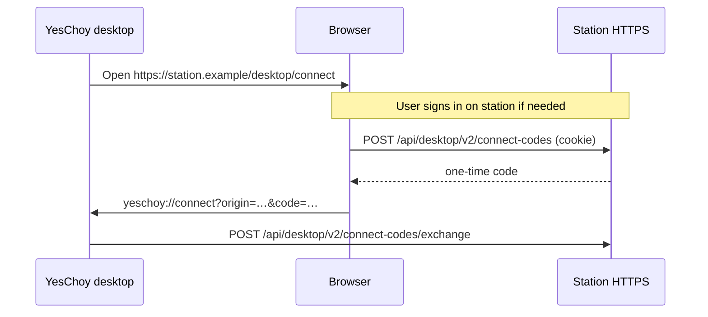

# Station connect page (`/desktop/connect`)

Third-party **New API** stations should expose a single-purpose HTTPS page so
desktop users can sign in on the site and open the YesChoy assistant with one
button. The desktop app opens this URL when the user enters a station origin on
the home screen.

## Fixed path

| Item | Value |
|------|--------|
| Path | **`/desktop/connect`** (exact, case-sensitive) |
| Full URL | `https://<your-station-host>/desktop/connect` |
| Scheme | `https` only (same rules as connect `origin`) |

Do not use alternate paths (`/connect`, `/yeschoy`, query aliases). The desktop
client always navigates to `/desktop/connect` on the canonical origin the user
entered.

## Reference implementation

Copy or proxy the template in this repository:

- **HTML**: [`public/desktop/connect/index.html (also connect.html)`](../public/desktop/connect/index.html (also connect.html))
- **Script**: [`https://yeschoy.app/connect.js`](https://yeschoy.app/connect.js)
  (see [`station-connect-embed.md`](./station-connect-embed.md))

The page contains **one primary button** (`data-yeschoy-connect`). The hosted
`connect.js` bundle issues `POST /api/desktop/v2/connect-codes` on your origin
(session cookie) and navigates to `yeschoy://connect?…`.

### Operator checklist

1. Serve `GET /desktop/connect` on the **same host** that holds the user session
   cookie used by `POST /api/desktop/v2/connect-codes`.
2. Implement the v2 connect-code issue + exchange APIs
   ([`station-connect-api.openapi.yaml`](./station-connect-api.openapi.yaml)).
3. Keep the page minimal: sign-in hint, one button, quiet download link in the
   footer (not a second primary CTA).
4. Prefer loading `connect.js` from `yeschoy.app` so protocol fixes ship
   without redeploying your static HTML.

### User flow

## Desktop entry

On the workbench home screen (signed out), users enter an HTTPS origin or domain.
The app validates it against the same origin rules as deep-link connect, switches
the account line to `station_connect:<origin>`, and opens the system browser at
`{origin}/desktop/connect`.

## Local development

`tools/station-connect-mock` serves the reference page at
`http://127.0.0.1:<port>/desktop/connect`. Issue/exchange still require a
TLS-terminated origin for real deep-link tests — see
[`station-connect-e2e-mock.md`](./station-connect-e2e-mock.md).
